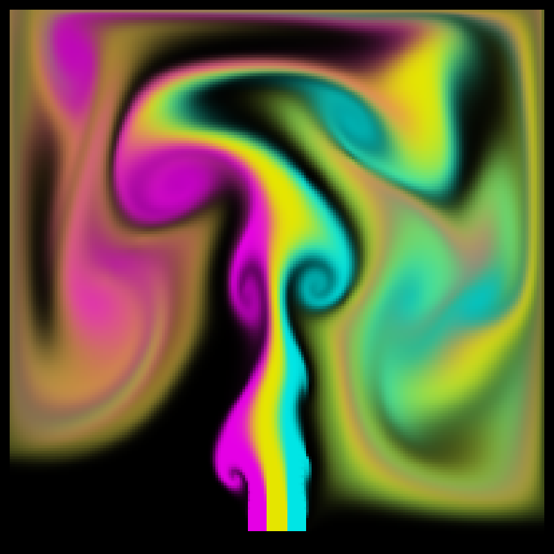

# Eulerian Fluid Simulator

A 2D Eulerian smoke simulator written in C++, rendered with OpenGL and freeglut. It uses a staggered grid, semi-Lagrangian advection, explicit viscosity and a pressure projection solved with preconditioned conjugate gradient.



## Controls

| Key | Action |
|---|---|
| `s` | Pause or resume |
| `g` | Show or hide the grid and velocity field |
| `Esc` | Quit |

## Options

```
Practica3.exe -test [advection|smoke] -gridsize [cells x] [cells y] -step [seconds]
```
